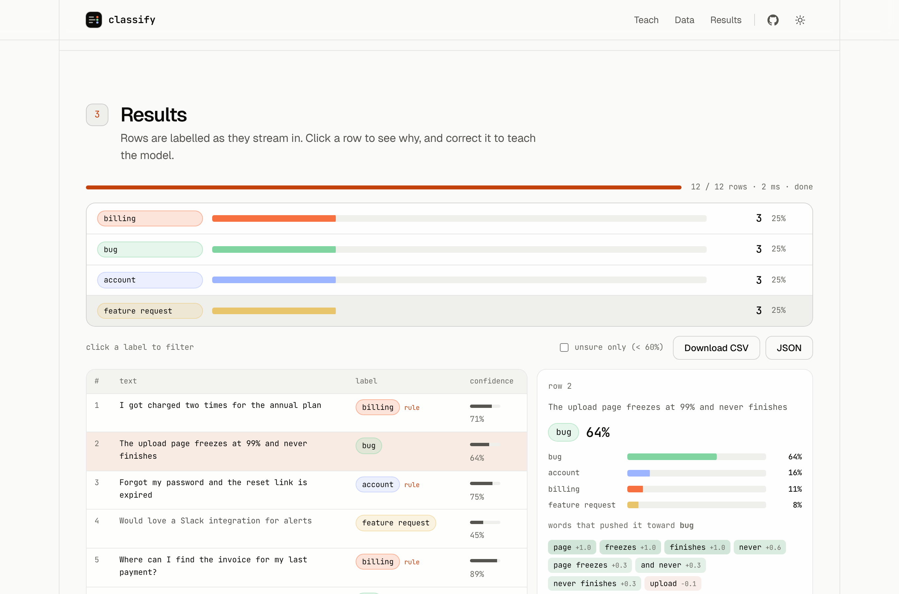

<div align="center">


# classify

**Teach it five examples. Label everything else.**

Classify any data in your browser: name your labels, give a few examples, drop in a CSV, Excel sheet, JSON or log file, and watch every row get labelled live, with the reason for each label.<br />
No server, no upload, no API key.

[Live app](https://shubhamcodess.github.io/classify/) · [Report an issue](https://github.com/shubhamcodess/classify/issues/new)



</div>

## How it works

1. **Teach.** Create labels. Each has a name, a few examples (one per line), an optional description and optional keyword rules. Start from a preset (log severity, support tickets, review sentiment) or from blank.
2. **Add data.** Drop a file or paste text:

   | Format | How rows are read |
   | --- | --- |
   | `.csv` `.tsv` | header row + rows (quotes, commas and newlines in cells handled) |
   | `.xlsx` `.xls` `.ods` | first sheet, header row + rows |
   | `.json` | array of objects or strings (also `{ "data": [...] }`) |
   | `.jsonl` `.ndjson` | one JSON value per line |
   | `.log` `.txt`, anything else | one row per line |

   Text columns are picked automatically; tick or untick columns to choose what gets classified.
3. **Results.** Rows stream into the table as they are labelled, with a live label distribution. Click a row to see the probability for every label, the words that pushed it, and whether a keyword rule fired. If it's wrong, click the right label: the row becomes a new example and everything re-classifies.
4. **Download** the original columns plus `label`, `confidence` and `rule` as CSV or JSON.

## The model

A multinomial Naive Bayes classifier written in plain JavaScript, with no ML library:

- **Features:** words, word pairs and character trigrams. Numbers are reduced to their length so ids and timestamps don't dominate.
- **Rules:** keywords give a strong boost to their label when the text contains them.
- **State:** your labels and examples are saved in the browser (`localStorage`) and can be exported or imported as JSON. Training is a single counting pass, so it re-trains on every edit in milliseconds.
- **Honesty check:** "self-test" is leave-one-out accuracy on your own examples.
- **Speed:** about 30,000 short rows per second on a laptop. The Excel parser (SheetJS) loads only when you open a spreadsheet.

It works best when labels differ in vocabulary (log levels, ticket topics, categories, sentiment). It does not understand meaning the way a large language model does, so add examples for the cases it gets wrong.

## Run locally

```bash
npm ci
npm run dev        # http://localhost:5173
npm test           # model and parser tests
npm run build      # static site in dist/
```

Pushing to `main` deploys to GitHub Pages through `.github/workflows/pages.yml` (one-time: Settings → Pages → Source: GitHub Actions).

## License

MIT © 2026 [Shubham Prakash](https://www.linkedin.com/in/shubham-prakash-dev/)
